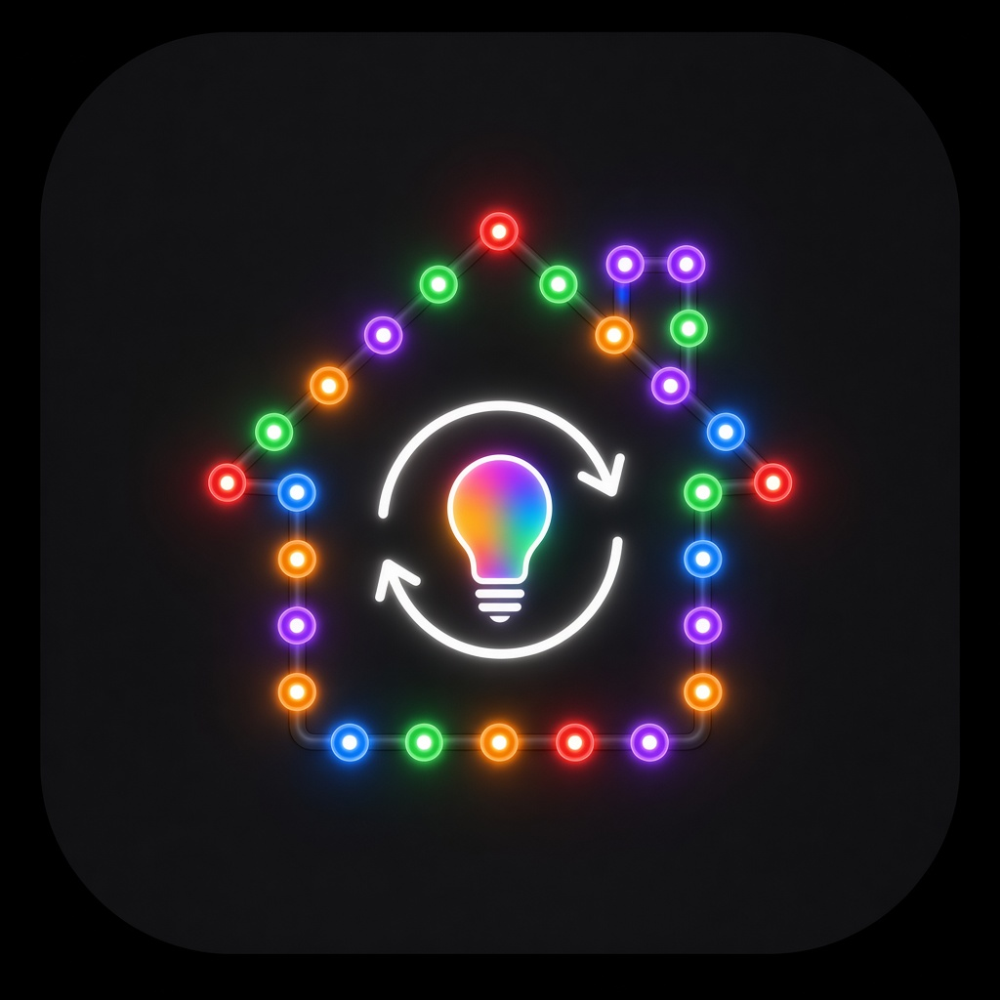

# GlowCast Card

Custom Home Assistant Lovelace card for the **GlowCast** integration (`domain: glowcast`).

**v0.2.2** — compact Bubble Card–style room pills with a bottom-sheet pop-up. Space-saving and mobile-first (iPhone).

> Do **not** install into HA until ready. Keep any installed v1 resource in place until you choose to upgrade the file.

## Features

- Compact grid of round room buttons (**All lights** + each room)
- Per-room icon (config override, else HA area icon, else `mdi:lightbulb-group`)
- Subtle glow/ring in the active theme’s colors when the room show is **on**
- Tap → bottom sheet; long-press or power-dot → quick show toggle
- Sheet: big on/off, horizontal theme swatch chips, Auto/Manual, effect chips, speed & brightness
- **Optimistic theme selection** — tapped theme highlights immediately; duplicate taps ignored while a change is pending (~5s or until entity confirms)
- **In-place DOM updates** — hass state pushes patch the UI without rebuilding controls (keeps tap handlers alive)
- Auto-discovers `platform: glowcast` entities; YAML `rooms:` / `columns:` overrides
- `getStubConfig` + config editor (icon fields; uses `ha-icon-picker` when available)

## Requires

Install the [GlowCast integration](https://github.com/riddledreality/glowcast) first (`domain: glowcast`).

## Install

### HACS (custom repository)

1. HACS → ⋮ → **Custom repositories**
2. Add `https://github.com/riddledreality/glowcast-card` as category **Dashboard**
3. Install **GlowCast Card**
4. Refresh Lovelace (or clear cache), then add the card to a dashboard

### Manual

1. Copy `glowcast-card.js` to `/config/www/glowcast-card.js`
2. Lovelace resource:

   ```yaml
   resources:
     - url: /local/glowcast-card.js
       type: module
   ```

3. Add the card to a dashboard.

## Example YAML

### Auto-discovery

```yaml
type: custom:glowcast-card
title: GlowCast
columns: 3
```

### Icons / names (recommended)

```yaml
type: custom:glowcast-card
title: GlowCast
columns: 3
rooms:
  all_lights:
    name: All lights
    icon: mdi:lightbulb-group
  kitchen:
    name: Kitchen
    icon: mdi:silverware-fork-knife
  nerd_cave:
    name: Nerd Cave
    icon: mdi:desktop-classic
```

### Full entity override (optional)

```yaml
type: custom:glowcast-card
title: GlowCast
rooms:
  - id: all_lights
    name: All lights
    icon: mdi:lightbulb-group
    all: true
    theme: select.glowcast_all_lights_theme
    power: switch.glowcast_all_lights_show
    mode: select.glowcast_all_lights_mode
    effect: select.glowcast_all_lights_effect
    speed: number.glowcast_all_lights_speed
    brightness: number.glowcast_all_lights_brightness
```

## Entity naming (live HA)

| Role | Entity pattern |
|------|----------------|
| Theme | `select.glowcast_<room>_theme` |
| Show | `switch.glowcast_<room>_show` |
| Mode | `select.glowcast_<room>_mode` |
| Effect | `select.glowcast_<room>_effect` |
| Speed | `number.glowcast_<room>_speed` |
| Brightness | `number.glowcast_<room>_brightness` |
| Color (clear) | `light.glowcast_<room>_color` |

Known rooms: `all_lights`, `kitchen`, `nerd_cave` (plus any future areas).

- Theme **options/state are keys** (`halloween`, `aurora`, …)
- Mode: `auto` / `manual` (Auto mode may select a holiday theme such as `halloween`)
- Effect: `static` \| `rotate` \| `breathe` \| `twinkle` \| `flicker`
- Registry `platform` must be `glowcast`

## Services called

| Control | Service |
|---------|---------|
| Show toggle | `switch.toggle` |
| Theme / Mode / Effect | `select.select_option` |
| Speed / Brightness | `number.set_value` |
| Solid color | `glowcast.set_color` `{ room, rgb_color: [r,g,b], brightness?: 0-100 }` |
| Clear color | `light.turn_off` on `light.glowcast_<room>_color` |

### Solid color (v0.2.1)

In the room sheet, **Solid color** expands an HSV wheel, recent swatches (last ~5 in `localStorage`), preset swatches, hex input, and Apply.

**Preferred service (Poke):**

```yaml
service: glowcast.set_color
data:
  room: kitchen          # all_lights | kitchen | nerd_cave | …
  rgb_color: [0, 122, 255]
  brightness: 80         # optional 0–100
```

While a solid color is active, theme select state is `custom_color` and theme/show entities expose `rgb_color` — the card shows a **Custom** chip and uses that RGB for the room glow ring.

**Clear color:** `light.turn_off` on `light.glowcast_<room>_color` (restores prior lights per Poke 0.1.2).

**Fallback** if `hass.services.glowcast.set_color` is missing: turn off the show switch, then `light.turn_on` on `light.glowcast_<room>_color` (or member lights) with `rgb_color` + `brightness_pct`.

Drag updates throttled (~300ms). Recent colors (last ~5) stored in `localStorage`.

The card follows the HA dashboard theme via CSS variables (`--ha-card-background`, `--primary-text-color`, `--primary-color`, `--divider-color`, `--switch-checked-color`, etc.).

## Interaction notes (v0.2)

- Theme chips update **optimistically** on tap. While a theme change is pending, further theme taps on that room are ignored so rapid double-taps don’t fight HA.
- Pending clears when the select entity state matches the tapped option, or after ~5 seconds.
- The card does **not** tear down and rebuild its DOM on every `hass` update; it patches room pills and the open sheet in place so listeners stay attached.

## Self-test

```bash
cd /workspace/glowcast-card
npm test
```

Produces / checks:

- `preview-v2-closed.png` — compact room grid (~390px)
- `preview-v2-popup.png` — bottom sheet open
- `preview-v2-color.png` — solid color picker open
- `preview-v2-dark.png` — dark theme + color panel
- `preview-v2-light.png` — light theme + color panel

## Files

| Path | Purpose |
|------|---------|
| `glowcast-card.js` | Card v0.2 |
| `glowcast-card.v1.js` | Previous expanded layout (reference; not for install) |
| `README.md` | This file |
| `preview-v2-closed.png` / `preview-v2-popup.png` | Mobile previews |
| `test/` | Harness + self-test |

## License

MIT
